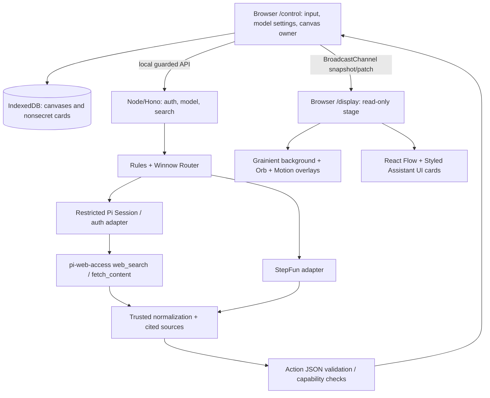

# Vivic v0.6 — 系统架构与模块边界

2026-10-15 范围补充：只支持 StepFun Coding Plan 与复用 Pi OAuth 的 GPT 两种 LLM。搜索、STT、TTS、VAD/KWS 分别建模和验证；GPT 未配语音仍可使用文字/卡片。StepFun 搜索优先验证同一 Plan Key 的官方 StepSearch。Sherpaw 本地语音仍待 PoC，不能视为已经上线。详见 [最新架构核查](../docs/provider-voice-architecture.md)。

## 1. 仅一个 Web 项目 + 薄 Node 本地服务



目录建议（非必须照搬路径）：

```text
apps/web/                    # React + Vite /control /display / (optional)
apps/local-api/              # Node + Hono (or existing trusted HTTP equivalent)
packages/contracts/          # Zod schemas, action types, card record, permissions
packages/canvas/             # React Flow adapter / layout / focus history
packages/cards/              # Card registry / minimal render mappings
packages/stage/              # Orb / Grainient / subtitle / overlay
packages/motion/             # declarative timeline director
packages/sync/               # BroadcastChannel snapshot/patch owner protocol
packages/persistence/        # IndexedDB nonsecret canvas and JSON export
packages/ai/                 # Winnow/StepFun/Pi adapters
packages/search/             # audited pi-web-access wrappers, sources normalizer
packages/speech/             # Sherpaw worker/PTT, short phrases, TTS adapter
```

## 2. UI 分层与架构原则

- `/control` 是所有输入和配置的地方（可将设置隐藏在单页 `/` 的左上角，但 `/display` 绝无入口）。
- `/display` **只读**，渲染 state 和 motion event，不持有模型 API Key/OAuth Token、不能调用 Pi。
- React Flow 坐标/视图与背景 canvas 独立；卡片 props schema 严格限定，任何 LLM 输出都先 validation。
- State 更新纯函数 reducer 为唯一入口；Motion Director 接收已确认的 StateTransition 事件；动画完成状态不再作为模型输入。

## 3. 核心 API 合约（建议）

```text
POST /api/credentials/stepfun/validate
POST /api/credentials/stepfun/disconnect
GET  /api/providers/status              # 仅公开 provider 名、ready 状态和 capability
POST /api/pi/login/start               # experimental; safe browser/manual flow only
POST /api/pi/logout
GET  /api/search/status                 # keyless route checked / degraded status
POST /api/search                       # query; results + sources; no arbitrary local path
POST /api/fetch                        # validated HTTPS URL; text/excerpts + sources
POST /api/intent                       # parsed intent and optional actions
POST /api/ai/compose                   # structured display data, only schema-approved
```

`/api/pi/login/start` 仅在 OAuth PoC 可用、完整 CSRF/state/token isolation 通过后实现，不允许直接向 `/display` 暴露认证操作。

## 4. 同浏览器两个窗口同步协议

`BroadcastChannel('vivic:canvas:v1')` 仅做**通知与状态传送**，IndexedDB 持久化非秘密数据。

- 角色：`CONTROL_OWNER`（唯一写入）、`DISPLAY_READER`；单页面模式可以合并 UI，但仍遵守唯一 owner。
- `hello` → `snapshot-request` → `snapshot` → `patch`；每条消息包含 `{type, canvasId, epoch, version, seq, requestId, payload}`。
- `patch` 仅在 version 匹配时应用；否则重拉 snapshot。丢帧与重复不应该重复卡片动作。
- 两个主控同时打开时应通过 Web Locks API / 心跳租约 / 消息选主策略维护单写入者；先验证浏览器支持并提供只读/接管提示。
- `BroadcastChannel` 不能跨不同浏览器实例、设备或不同 origin 保证可达；外接电视另加 WebSocket 和配对，Roadmap 阶段实现。

## 5. 画布数据与“轻量记忆”

`CanvasRecord:{id,title,version,updatedAt,cardsById,viewport,focusHistory,recentReferences}`；持久化非秘密数据。每张卡片 `sourceData` 保留后续对话语义，`displayProps` 控制可见内容。

LLM Context Builder 按当前画布筛选：卡片类型、标题/alias、sourceData 摘要、source URL、最近焦点/提及和用户当前指令；设置 token 上限和敏感字段过滤。**不发送其他画布长篇历史聊天，也不存无休止会话。**

IndexedDB 不是不可丢失数据库，因此首版包括 JSON 导出/导入、schema 迁移、删除与恢复测试。

## 6. Pi 搜索架构

首选 `PiAdapter`（使用 `@mariozechner/pi-coding-agent` 的受限 session/认证） + `pi-web-access` Pi extension；只有**明确审核并经过包装**的 `web_search`、`fetch_content` 能开放给模型。禁用宿主默认 extensions/skills 自动发现。默认工具不包含 read/write/edit/bash。

如果 Pi 扩展运行时约束太难做，可选择 `pi-web-access` 独立 MCP 模式隔离。此模式不保证 Pi OAuth/Codex search 模型上下文能复用；保留检测状态。**任何模式都要防止 URL SSRF 和本地路径访问**，不能直接向用户暴露广泛 `fetch_content` 能力。

每次搜索结果结构：

```ts
interface SearchEvidence {
  title: string;
  url: string;
  snippet?: string;
  fetchedAt: string;
  provider: string;
  readFullPage: boolean;
}
```

没有 `readFullPage: true` 就不能说「已阅读完整网页」。外部 HTML/Markdown 只当非可信数据。

## 7. Provider 与音频

`ProviderAdapter = {status, listModels, generateStructured, supportsVision?, supportsTTS?}`；StepFun BYOK 是稳定必做，Pi 登录个人 PoC 属于有条件支持，不能假设所有 provider 都有所有功能。

输入优先文本闭环；浏览器 PTT Sherpaw ASR/VAD 使用独立 Worker 并经过用户麦克风授权；KWS 可选。TTS 和短预录语音有自动降级；不与后台网络请求串行阻塞 UI。

## 8. 失败边界与安全

- 本机 HTTP 仅监听 `127.0.0.1`，Origin/CSRF/session 防护、限流与请求大小限制，不对局域网暴露凭据 API。
- StepFun Key 仅服务内存或 OS 安全库；Pi OAuth 仅 Pi 隔离认证存储，不回传 Token。
- 超时、断网、零配置搜索配额或服务不可用必须显式反馈；不能生成假的搜索结果。
- 必须做 URL allowlist/deny local+private IP、DNS 重绑定/重定向验证、网页注入防御、响应大小限制和审计记录（脱敏）。
- 不允许通过“系统提示词”替代工具能力封锁；工具根本不能注册或暴露。
